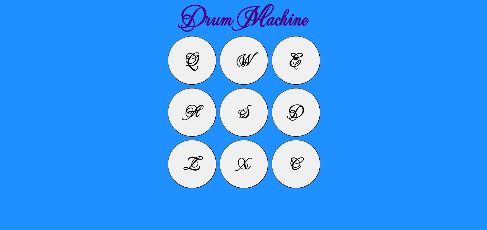
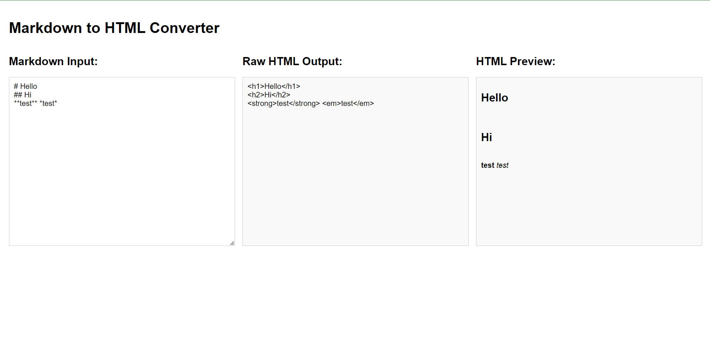
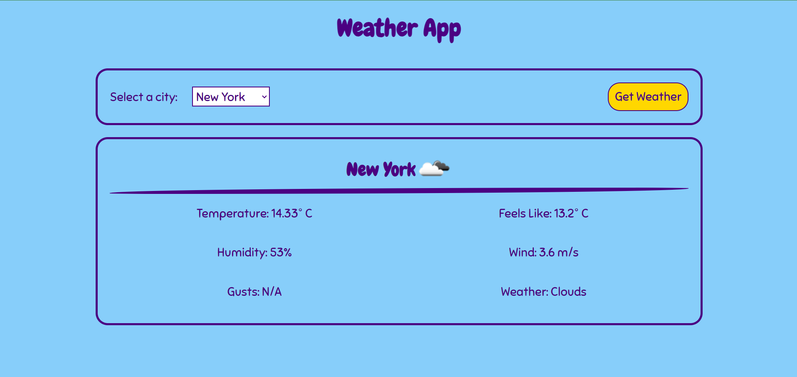

# freeCodeCamp-javascript-challenges
Challenges from freeCodeCamp (https://www.freecodecamp.org/).

A collection of projects I worked on while brushing up my JavaScript 
skills through the [freeCodeCamp JavaScript Certification (Version 9)](https://www.freecodecamp.org/learn/javascript-v9/).

Enjoy my solutions and experiments!

## Technologies

This repository focuses on JavaScript fundamentals and browser-based application development, 
with projects developed using:

- JavaScript 
- HTML5
- CSS3
- DOM manipulation
- Event handling
- Asynchronous JavaScript (`async`/`await`, Promises, Fetch API)
- Error handling
- Data structures and object-oriented programming
- JSON data handling
- Responsive design
- CSS Flexbox and Grid
- CSS Custom Properties (Variables)
- Web typography

## Projects

1. **Build a Bank Account Management Program**

   A JavaScript program that models bank account operations and account management, 
exploring object-oriented programming, data handling, and application logic.

2. **Build a Drum Machine**

   An interactive drum machine that plays audio samples when the user activates drum pads. 
The project explores DOM manipulation, event handling, audio playback, and responsive styling.

    

          
    

3. **Build a Markdown to HTML Converter**

   A converter that transforms Markdown input into HTML output, exploring string processing, 
parsing logic, and dynamic content generation.

    

          
    

4. **Build a Voting System**

   A voting system that models voting operations and processes votes, exploring data management, 
validation, and application logic.

5. **Build a Weather App**

   A weather application that retrieves weather data for a selected city through an API and 
displays current weather conditions, including temperature, humidity, wind, and weather icons. 
The project explores asynchronous JavaScript, the Fetch API, JSON responses, error handling, 
and dynamic DOM updates.

    

          
    

## Credits

This repository contains projects completed while following the [freeCodeCamp JavaScript Certification (Version 9)](https://www.freecodecamp.org/learn/javascript-v9/) curriculum.

Third-party assets, including fonts and audio samples, remain the property of their respective authors and retain their original licenses.

## Contacts

Agnese Salutari – agneses92@gmail.com

Licensed under the Apache License 2.0. See `LICENSE` for more information.

[https://github.com/agnsal](https://github.com/agnsal)

